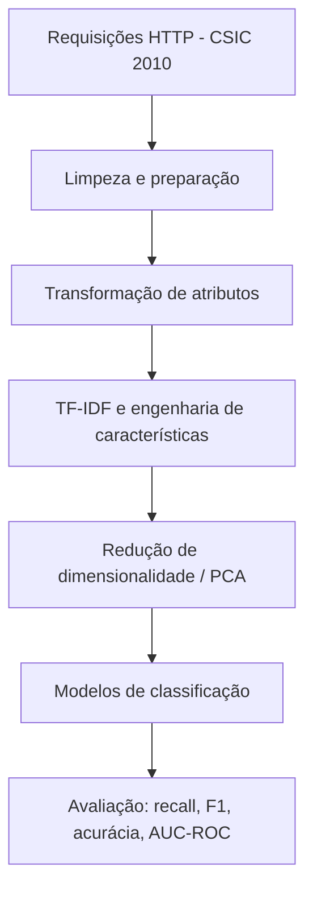

# Detecção de Ataques em Aplicações Web com Machine Learning

> Projeto acadêmico de Ciência da Computação — Universidade Paulista (UNIP), 2025.

**Autores:** Gabriel Mani Ananias e Eloisa Vitória Rodrigues.  
**Orientador:** Prof. João Otávio Gonçalves Calis.

## Visão geral

Documentação técnica do TCC sobre classificação de requisições HTTP normais e anômalas usando aprendizado de máquina. O estudo utilizou o **HTTP Dataset CSIC 2010** e comparou classificadores com métricas de segurança de aplicações web.

**Situação:** portfólio documental, baseado no TCC. O **código-fonte original, os modelos treinados e os dados ainda não estão disponíveis neste repositório**. Resultados abaixo são reportados no trabalho e **não foram reproduzidos aqui**.

## Objetivo

Comparar modelos para identificar requisições HTTP potencialmente maliciosas, priorizando **recall**, **F1-score** e **AUC-ROC**. Este trabalho não é scanner de vulnerabilidades, ferramenta de pentest nem solução implantada em produção.

## Dataset

- **HTTP Dataset CSIC 2010**
- **61.065** requisições HTTP, em **17** colunas, segundo o TCC
- Alvo: `classification`, 0 = normal, 1 = anômala
- Cerca de **41%** das amostras foram descritas como ataques

O dataset não está incluído; consulte a fonte e suas condições de uso.

## Fluxo metodológico descrito



O TCC discute TF-IDF, PCA e atributos derivados de URL e conteúdo HTTP. Sem os scripts originais, a ordem e as variantes implementadas não podem ser totalmente verificadas. Veja [Metodologia](docs/METODOLOGIA.md).

## Resultados reportados no TCC

| Modelo | F1-score da validação cruzada |
|---|---:|
| **Gradient Boosting** | **0,9257** |
| XGBoost | 0,9195 |
| Random Forest | 0,9074 |
| Logistic Regression | 0,7839 |
| Naive Bayes | 0,4720 |

- **Gradient Boosting:** acurácia de **94%** e AUC-ROC **0,988**, conforme o trabalho.
- **XGBoost:** recall **0,95** para a classe anômala na tabela apresentada.
- A metodologia cita também SVM, sem tabela consolidada comparável para ele.

Essas métricas são históricas e não garantem desempenho em tráfego real. Veja [Resultados e ressalvas](docs/RESULTADOS.md).

## Tecnologias documentadas

Python 3.11 · pandas · NumPy · scikit-learn · NLTK · XGBoost · Matplotlib · Seaborn · TF-IDF · PCA. O ambiente descrito foi Ubuntu 22.04. A lista não constitui dependências testadas deste repositório.

## Estrutura

```text
README.md
docs/
  METODOLOGIA.md
  RESULTADOS.md
  PROXIMOS_PASSOS.md
.gitignore
```

## Próximos passos

Para torná-lo executável, faltam os scripts ou notebooks originais, dependências verificadas, dados obtidos de fonte autorizada, execução de testes e alinhamento com a coautora para publicação de materiais compartilhados. Veja [Plano](docs/PROXIMOS_PASSOS.md).

## Autoria e reconhecimento

Trabalho desenvolvido por **Gabriel Mani Ananias** e **Eloisa Vitória Rodrigues**, sob orientação de **Prof. João Otávio Gonçalves Calis**, na **Universidade Paulista (UNIP)**. A adaptação disponibiliza apenas documentação resumida, não o texto integral nem código original; nenhuma licença aberta é presumida para material compartilhado.
