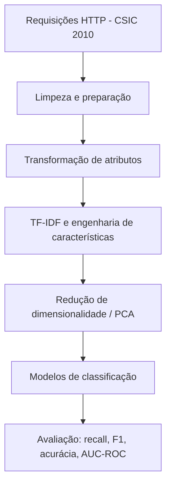

# Análise de Vulnerabilidades em Aplicações Web

**Trabalho de Conclusão de Curso — Ciência da Computação**  
Universidade Paulista (UNIP), 2025.

**Autores:** Gabriel Mani Ananias e Eloisa Vitória Rodrigues.  
**Orientador:** Prof. João Otávio Gonçalves Calis.

## Resumo da pesquisa

Documentação técnica do TCC sobre classificação de requisições HTTP normais e anômalas usando aprendizado de máquina. O estudo utilizou o **HTTP Dataset CSIC 2010** e comparou classificadores com métricas de segurança de aplicações web.

Esta publicação reúne os objetivos, a metodologia e os resultados registrados no Trabalho de Conclusão de Curso. O estudo foi conduzido pelos autores utilizando técnicas de aprendizado de máquina para classificação de requisições HTTP.

## Objetivo

Comparar modelos para identificar requisições HTTP potencialmente maliciosas, priorizando **recall**, **F1-score** e **AUC-ROC**. A pesquisa aborda a classificação de tráfego HTTP como objeto de estudo de segurança de aplicações web.

## Dataset

- **HTTP Dataset CSIC 2010**
- **61.065** requisições HTTP, em **17** colunas, segundo o TCC
- Alvo: `classification`, 0 = normal, 1 = anômala
- Cerca de **41%** das amostras foram descritas como ataques

O dataset não está incluído; consulte a fonte e suas condições de uso.

## Metodologia da pesquisa



O TCC discute TF-IDF, PCA e atributos derivados de URL e conteúdo HTTP. A metodologia está detalhada em [Metodologia da pesquisa](docs/METODOLOGIA.md).

## Resultados reportados no TCC

| Modelo | F1-score da validação cruzada |
|---|---:|
| **Gradient Boosting** | **0,9257** |
| XGBoost | 0,9195 |
| Random Forest | 0,9074 |
| Logistic Regression | 0,7839 |
| Naive Bayes | 0,4720 |

- **Gradient Boosting:** acurácia de **94%** e AUC-ROC **0,988**, conforme o trabalho.
- **XGBoost:** recall **0,95** para a classe anômala na tabela apresentada.
- A metodologia cita também SVM, sem tabela consolidada comparável para ele.

Os valores correspondem aos resultados documentados no estudo. Veja [Resultados e discussão](docs/RESULTADOS.md).

## Tecnologias e conceitos abordados

Python 3.11 · pandas · NumPy · scikit-learn · NLTK · XGBoost · Matplotlib · Seaborn · TF-IDF · PCA. O ambiente descrito foi Ubuntu 22.04. 

## Estrutura

```text
README.md
docs/
  METODOLOGIA.md
  RESULTADOS.md
  ESCOPO.md
.gitignore
```

## Documentação acadêmica

O documento original apresenta os procedimentos e resultados do estudo, mas não inclui scripts ou notebooks executáveis. Esta publicação, portanto, reúne documentação e não código-fonte, dados ou modelos treinados. Consulte [Escopo da publicação](docs/ESCOPO.md).

## Autoria e reconhecimento

Trabalho desenvolvido por **Gabriel Mani Ananias** e **Eloisa Vitória Rodrigues**, sob orientação de **Prof. João Otávio Gonçalves Calis**, na **Universidade Paulista (UNIP)**. 
